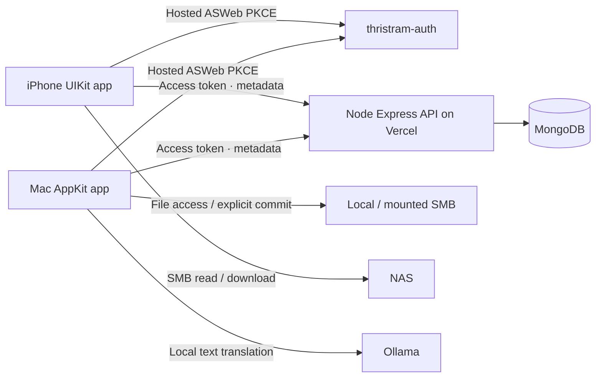

# System specification

## Components

Media is not stored in MongoDB or uploaded to the API. Storage-root records are account-owned logical references. Device bindings contain bookmarks or NAS host/share/base path and credentials. NAS credentials stay in each device's Keychain. Two people pointing at the same NAS folder still have separate app metadata; the NAS's own authorization governs physical file access.

## Data model v1

- `author`: creator name/site IDs; unknown creator is an ordinary account-owned author titled `other author`.
- `series`: optional group, optionally linked to an author.
- `work`: comic group linked to author, optionally series.
- `chapter`: required author; optional work/series; holds actual `media[]`.
- `tag`: reusable account vocabulary entry. `nsfw=true` identifies NSFW visibility semantics.
- `storageRoot`: logical root, title and `storageKind=local|smb`. A local root may have a different device binding to the same NAS content.

Each entity uses a UUID, integer revision, updated timestamp and deletion tombstone. Server-only `ownerId` is SHA-256 of canonical issuer + NUL + verified subject. Responses omit it except `/v1/me` account identity. Never derive ownership from email or client-provided metadata.

`localizations[locale] = {title?, description?}` represents text only. Missing fields fall back separately to original `title` / `description`; an existing translation of the title does not suppress the original description. `originalLanguage` defaults to `und` if unknown. UI locale (`en`) and content preference (`zh`) are distinct.

A `MediaVersion` has UUID, language, `kind=images|pdf|video`, storageRootId, ordered safe relative paths, pageCount and optional pageAlignment. Image files are one ordered path per page; PDF/video use one file, PDF has its actual page count and video counts as one chapter page. Alignment maps canonical page index to that version's page index; null denotes unmapped. The initial reader supports numeric mappings; the alignment editor and unmapped media fallback are pending.

Personal state belongs to the same account and references an entity. State key is `entityId:entity` or `entityId:pageIndex`. Favorite and starred are independent booleans. Chapter progress references a media UUID and zero-based page index, completion and activeSeconds. Current activeSeconds is reserved and remains zero until actual activity measurement lands. State revisions use compare-and-swap, like metadata.

## Organization policy

The intended path is `author/[series]/[work]/chapter/[language]`. Include language only when a chapter has multiple actual media languages. Skip empty optional levels. Reject path separators, traversal, NUL and invalid components. Never rewrite filesystem names just because titles/localizations changed.

Author A with one chapter: `Author A/Chapter 1/1.jpg`. With a comic: `Author A/Comic/Chapter 1/1.jpg`. With Japanese + Chinese media: `Author A/Comic/Chapter 1/ja/1.jpg` and `.../zh/1.jpg`. Adding a Chinese **text title** leaves the Japanese images at their original single-language path.

## Import and file commit

Discovery is recursive and skips symlinks/hidden entries. A folder with direct images becomes a candidate; nested image folders become additional candidates. PDF/MP4/WebM files become individual candidates. Use natural filename ordering (`2` before `10`); imported folder name supplies initial title. Mixed folders disable automatic whole-folder moving in this milestone.

Intended import steps: discover → review thumbnails → resolve author/comic/tags/links → optionally align a media translation → persist metadata → review file plan → explicit commit. Processing is sequential. The primary import action includes explicit file movement; ordinary metadata edits never do.

Current mover uses same-volume filesystem rename with collision checks and account-local JSON journals. Initial metadata describes source locations; a successful move updates media root and paths. A crash/failed API update leaves a `filesMoved_metadataPending` journal and metadata recovery payload. See [migration/recovery](data-migration.md). Cross-volume verified copy/delete, SMB-native rename journal recovery and idempotent import retries remain required before P0 release.

Finder tags are a data-plane projection of favorite/star metadata. Their failure must not erase successful metadata writes or unrelated Finder tags. The current milestone does not apply Finder tags yet.

## Sync and concurrency

Current v1 uses a complete account snapshot every 30 seconds while an app is open, and on explicit refresh / iPhone foreground. It includes tombstones and NSFW metadata so clients can apply inheritance. Snapshot is bootstrap-only, bounded at 10,000 entities and 10,000 states; it is not a transactional point-in-time snapshot across collections. The next poll reconciles concurrent writes.

Writes send the current integer revision via `If-Match`; a stale write returns 409. No automatic last-writer-wins. Initial apps require a connection for writes; failed reads may retain already-loaded metadata, but reopening requires online account verification. Persisted offline outbox, conflict-resolution UI, incremental cursor and bounded offline re-entry are pending. There is no claim that this milestone supports a complete offline sync protocol.

Planned release sync: durable owner-scoped local database/outbox, mutation UUID/idempotency, per-account change sequence committed with mutations in MongoDB transactions, tombstone retention and explicit merge UI. Progress must reconcile reading sessions rather than always take maximum page (rereads can legitimately move backwards).

## Visibility

NSFW inherits from direct flags, NSFW tags, author, series and work. Default list/detail/state endpoints filter it. Sync contains full private metadata; every client view must apply the same predicate before rendering covers, search results, history, favorites, downloads or statistics. The preference reveals content without deleting data or downloads.

## Security and boundaries

- Verify access-token signature/JWKS or configured introspection, canonical issuer, expiry, subject, API audience and endpoint scope.
- Native ID token has **client ID** audience and nonce; API access token has **API resource** audience. They are not interchangeable.
- Native identity validation supports Thristram's configured EdDSA / Ed25519 tokens using CryptoKit. Other ID-token algorithms fail closed; expand using a tested JWT library if issuer configuration changes.
- iPhone requests read/state scopes; Mac additionally manage. Backend checks scope independently of client UI.
- Every entity/state/reference lookup includes verified owner. No user-provided Mongo query operators or arbitrary absolute file paths are accepted.
- Keychain token rotations serialize. Sign-out removes OAuth credentials and clears in-memory data; retained account files are inaccessible through the signed-out app.
- NAS credentials are account/root-specific Keychain entries. SMB3 encrypted shares are used by the iPhone adapter. Clients check relative paths before fetching.
- Planned multi-document management transactions must close reference-delete races; per-document revisions alone do not solve that release requirement.

## Native frameworks

AppKit / UIKit handle grids, sheets, navigation and system chrome. AuthenticationServices handles hosted login. PDFKit handles PDF pages; ImageIO/system decoders handle images; AVKit/AVFoundation handle supported videos; QuickLookThumbnailing supplies Mac cover/file thumbnails. AMSMB2 4.0.3 provides SMB2/3 and is linked dynamically. Full codec compatibility, gesture/zoom polish and distribution licensing checks are release acceptance tasks.
